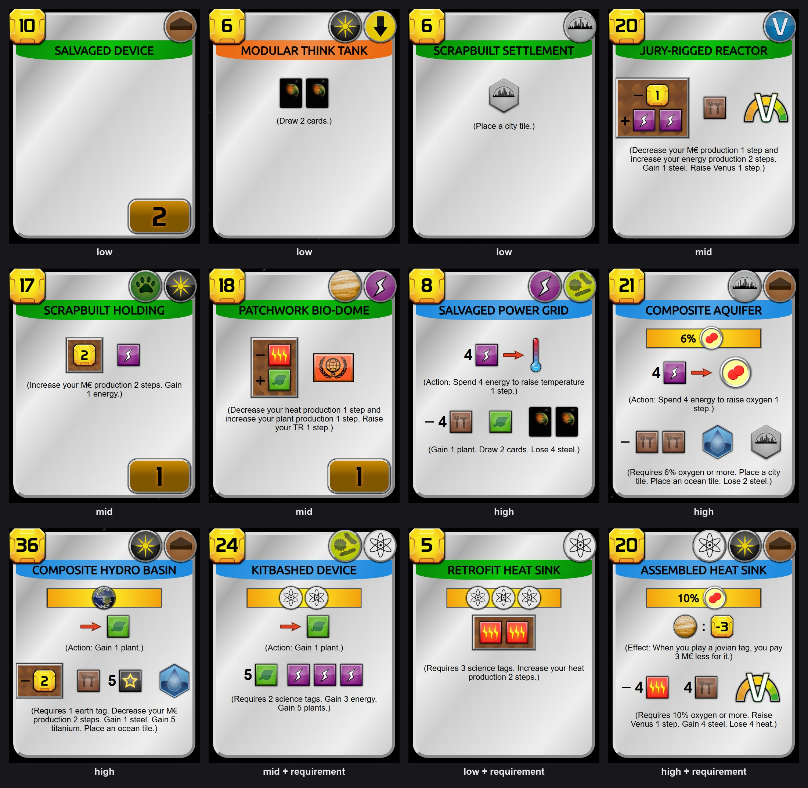

# Assembler demo cards

`demo-cards.jpg` shows 12 cards from the real generator (`src/server/assembler/`), drawn by the game client.
Regenerate them with `LOCAL_FS_DB=1 npx tsx src/server/tools/assembler_demo.ts`, start the server, and open the URL it prints.

The rest of this page (and `demo-cards.html`) is the earlier prototype's output, from `analysis/demo-generate.js`, kept for its value breakdowns.

## Prototype output

Seed 42

### ASM-01 · low — **4 M€**
Event (red) · tags: microbe

- Draw 2 cards.  _(+6.0)_

Value: parts +6.0, tags +1.0 = 7.0 → cost 4

### ASM-02 · low — **11 M€**
Event (red) · tags: venus · Requires 10% Venus or less.

- Place a greenery tile and raise oxygen 1 step.  _(+14.0)_

Value: parts +14.0, tags +1.4, requirement −1.7 = 13.7 → cost 11

### ASM-03 · low — **6 M€**
Event (red) · tags: earth

- Gain 4 steel.  _(+8.0)_

Value: parts +8.0, tags +1.4 = 9.3 → cost 6

### ASM-04 · mid — **7 M€**
Active (blue) · tags: space · Requires 5 oceans or more.

- Gain 5 M€.  _(+5.0)_
- Gain 2 plants.  _(+4.6)_
- Effect: your earth cards cost 1 M€ more.  _(−1.3)_

Value: parts +8.3, tags +3.0, requirement −3.3 + payment 1 + 10% of cost = 9.7 → cost 7

### ASM-05 · mid — **19 M€**
Active (blue) · tags: plant, wild

- Decrease any player's heat production 1 step.  _(+2.5)_
- Gain 2 M€.  _(+2.0)_
- Increase your plants production 2 steps.  _(+12.0)_
- Effect: when you play a plant tag, you pay 2 M€ less for it.  _(+3.5: 2 × 8 × 0.11 × 2)_
- Decrease your energy production 1 step.  _(−6.0)_

Value: parts +14.0, tags +7.6 = 21.6 → cost 19

### ASM-06 · mid — **18 M€**
Automated (green) · tags: venus · Requires 1 venus tag.

- Raise oxygen 1 step.  _(+8.5)_
- Increase your energy production 1 step.  _(+6.0)_
- Draw 2 cards.  _(+6.0)_
- Lose 2 heat.  _(−2.4)_

Value: parts +18.1, tags +3.6, requirement −1.0 = 20.7 → cost 18

### ASM-07 · high — **25 M€**
Active (blue) · tags: building, power

- 1 VP.  _(+5.0)_
- Place an ocean tile.  _(+11.0)_
- Increase your M€ production 2 steps.  _(+8.0)_
- Action: spend 2 energy to gain 2 plants.  _(+8.8: 2.2 × 4 uses)_
- Decrease your heat production 1 step.  _(−4.5)_
- Lose 6 M€.  _(−6.0)_

Value: parts +22.3, tags +3.4 + payment 1 + 5% of cost = 27.9 → cost 25

### ASM-08 · high — **19 M€**
Active (blue) · tags: science, earth · Requires 2 earth tags.

- Gain 3 plants.  _(+6.9)_
- Gain 4 heat.  _(+4.8)_
- Increase your steel production 1 step.  _(+7.0)_
- Effect: when you play a science tag, gain 2 heat.  _(+5.8: 2.4 × 2.4 triggers)_
- Decrease your energy production 1 step.  _(−6.0)_

Value: parts +18.5, tags +6.3, requirement −2.8 = 21.9 → cost 19

### ASM-09 · high — **29 M€**
Active (blue) · tags: plant, space

- Increase your plants production 2 steps.  _(+12.0)_
- Gain 2 steel.  _(+4.0)_
- Raise temperature 1 step.  _(+8.5)_
- Effect: when you play an earth tag, you pay 2 M€ less for it.  _(+5.1: 2 × 8 × 0.16 × 2)_
- Decrease your energy production 1 step.  _(−6.0)_

Value: parts +23.6, tags +4.6 + payment 1 + 10% of cost = 32.1 → cost 29

### ASM-10 · mid · guaranteed requirement — **24 M€**
Active (blue) · tags: building, science · Requires 5 space tags.

- Increase your M€ production 3 steps.  _(+12.0)_
- Draw 2 cards.  _(+6.0)_
- Gain 5 plants.  _(+11.5)_
- Action: spend 2 energy to gain 2 plants.  _(+8.8: 2.2 × 4 uses)_
- Lose 4 steel.  _(−8.0)_

Value: parts +30.3, tags +5.6, requirement −11.2 + payment 1 + 5% of cost = 26.9 → cost 24

### ASM-11 · low · guaranteed requirement — **5 M€**
Automated (green) · tags: space · Requires 2 building tags.

- Draw 2 cards.  _(+6.0)_

Value: parts +6.0, tags +3.0, requirement −2.8 + payment 1 + 10% of cost = 7.6 → cost 5

### ASM-12 · high · guaranteed requirement — **24 M€**
Active (blue) · tags: power, building, plant · Requires -16 °C or more.

- Gain 6 M€.  _(+6.0)_
- 2 VP.  _(+10.0)_
- Effect: when you play a building tag, you pay 2 M€ less for it.  _(+9.9: 2 × 8 × 0.31 × 2)_
- Decrease your M€ production 1 step.  _(−4.0)_

Value: parts +21.9, tags +5.0, requirement −2.2 + payment 1 + 5% of cost = 26.9 → cost 24

